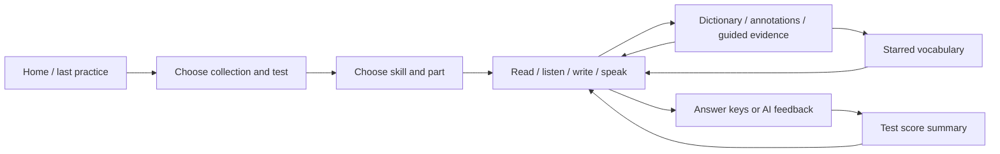
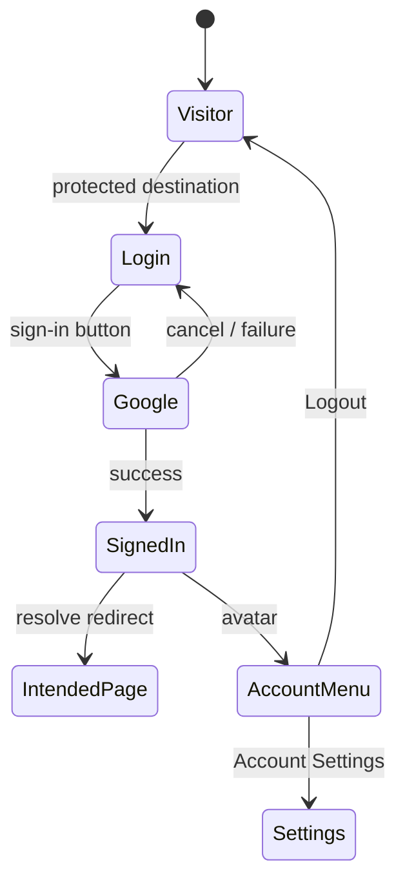
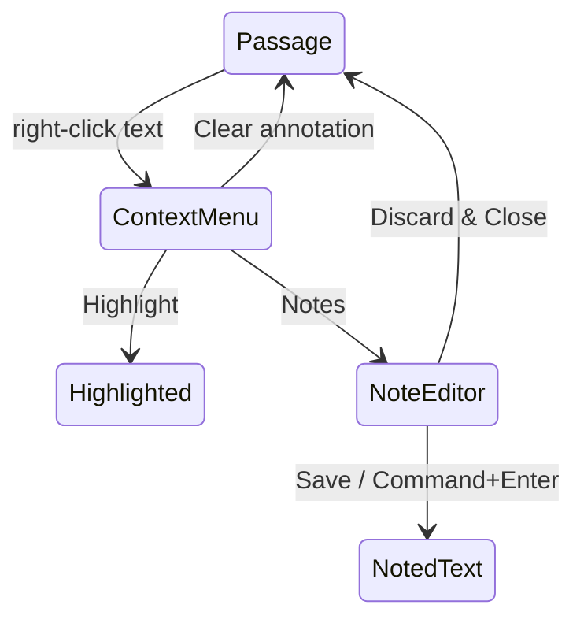
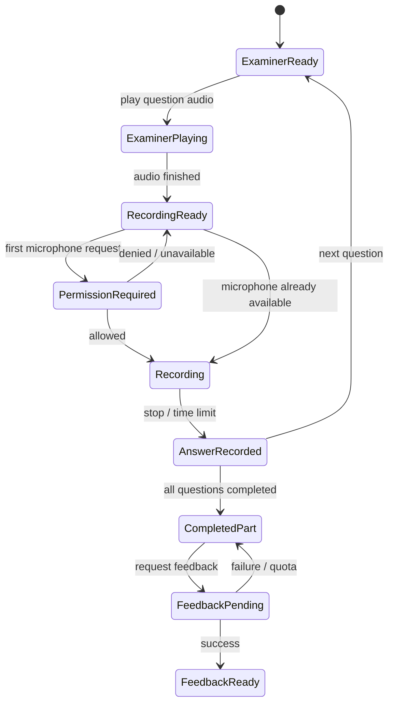

# Jumpinto UI and user-flow analysis

Inspected on 8 October 2026 in the user's signed-in Chrome browser, plus the signed-out public interface. Scope: reproduce the interface and its interaction states; implement our own application logic later. No access to the original backend is required.

**Evidence labels:** **Observed** means visible in the browser. **Inferred** means a proposed implementation consistent with the interface, not a verified statement about Jumpinto's internals. **Unverified** identifies a state that was not exercised. Existing account data was used only to inspect the structure of completed feedback; it is not included as application fixtures.

## 1. Product structure

Jumpinto is a practice workspace rather than a course LMS. The core loop is:



The public home demonstrates the product before sign-in. The catalog and practice pages require sign-in in the observed signed-out session. Signing in returns the user to their intended destination through a `redirect` query parameter.

### Route map

| Screen | Observed route | Identity / important state |
|---|---|---|
| Public home | `/` | Signed-in and signed-out header variants; last-practice state |
| Login | `/login?redirect=…` | Google sign-in; target destination |
| Academic catalog | `/ielts/practice/home` | Collection, test, skill; score badges |
| General Training catalog | `/ielts/practice/general-training` | Reading only |
| Listening | `/ielts/practice/:type/:book/:test/listening/:part` | 4 parts |
| Reading | `/ielts/practice/:type/:book/:test/reading/:part` | 3 Academic passages; General Training is content-dependent (5 observed) |
| Writing | `/ielts/practice/academic/:book/:test/writing/:part` | 2 tasks |
| Speaking | `/ielts/practice/academic/:book/:test/speaking/:part` | 3 parts |
| Test scores | `/ielts/practice/:type/:book/:test/score` | Whole-test summary and detailed review |
| Vocabulary | `/ielts/vocabulary` | Dictionary search and starred list |
| Account settings | `/settings/account` | Profile information and deletion |
| About | `/about` | Product description, support, policy links, service status |
| Privacy / terms | `/privacy`, `/terms` | Public information pages |
| Status | `https://status.jumpinto.com/` | External destination linked from About |

**Observed collection coverage:**

- Academic collections 21 through 1: four tests each.
- Academic EG (2014): four tests.
- Academic OG (2014): eight tests.
- Total Academic test identities: 96. Each exposes Listening, Reading, Writing, Speaking, and Scores.
- General Training collections 21 through 14: four tests each. Collection 10: two tests. Total: 34 test identities. The visible catalog exposes **Reading only**, not four skills.
- Thus the catalog contains 130 test identities. The UI should be driven by a collection manifest, not by assuming every collection has four tests or every type has four skills.
- Derived Academic route count: 96 × (4 Listening + 3 Reading + 2 Writing + 3 Speaking + 1 Scores) = 1,248 part/score destinations. General Training passage counts must come from the test manifest; the inspected Academic 21 counterpart has five General Training passages. A total General Training route count has not been established for every test, so no universal three-part assumption should be used.

## 2. Shared shell and visual system

**Observed:** white background, Inter font, black text, navy brand, green practice accents, red accents for the newest Academic collections, pale grey cards, modest borders/shadows, and rounded controls.

| Element | Behavior |
|---|---|
| Duck logo | Home destination |
| Jumpinto wordmark | Context-aware catalog destination: Academic or General Training; login links to the public home. Hover can change its color |
| Sun icon | Light/dark appearance switch; light appearance inspected, dark appearance not compared exhaustively |
| Envelope icon | Copies `team@jumpinto.com`; toast says “Email copied” and “Email address has been copied to clipboard.” It does **not** open a contact form |
| Login button | Visible when signed out |
| User avatar | Opens name, email, Account Settings, and Logout menu |
| Practice timer | Centered in header for Listening/Reading/Writing; not present in the Speaking screen inspected |
| Bottom practice navigation | Fixed at bottom; previous skill, part buttons, next skill |

Desktop practice is nearly full width, split evenly into two independently scrolling columns. The header is about 56 px high; bottom navigation occupies roughly 60 px. The passage/prompt stays in the left pane and response controls stay in the right pane. Do not make the entire desktop screen scroll as one document.

The home uses a centered ~960 px content area. The catalog uses a wider centered two-column collection grid; each collection has four test cards across. The score page uses a centered ~768 px content column. Account settings uses ~832 px. The Answer Keys drawer is approximately 540 px wide and enters from the **left**.

**Observed at 390 × 844:** Reading stacks the left and right panes vertically. Regular practice navigation follows the content rather than staying fixed at the bottom. The preview was corrected to match. Other mobile screen families and precise breakpoint boundaries still require further comparison.

## 3. Home and discovery

**Observed home composition:**

1. First card: interactive listening sample on the left; practice book covers on the right.
2. Listening sample: title “Inside Coleman's Guitar Experience,” native 27-second audio controls, expanded Audioscript, a Coordinator surname field, and a key button.
3. Three covers link to Academic 21, Academic 18, and Academic OG Listening Part 1.
4. Release link opens Academic 21 Test 1 Reading Part 1.
5. General Training link opens its separate catalog.
6. Last-practice area is empty/label-only for a visitor; the signed-in session showed a saved part identifier and content title linking to that part.
7. “More Practice Tests” opens the catalog.
8. Second card: two vocabulary examples, “My Starred Words,” and reading excerpts with guided highlights and question badges.
9. Footer links About, Privacy, Terms.

**Logic to implement:** record last visited practice identity and title after a successful part load; restore it to the home without coupling it to the current timer or feedback state. The demonstration field is separate from the real exam answer store.

## 4. Authentication and account flow



**Observed:** login shows Google sign-in rather than a username/password form. The Google control may load after a temporary full-screen loading overlay. Signed-in header uses a circular avatar. Account settings displays read-only Name and Email, then a red Danger Zone with Delete Account.

**Unverified:** fresh-account onboarding, Google cancellation/error copy, exact delete confirmation, and deletion outcome. No original account was deleted and no new account was created during inspection.

**Our UI implementation:** Google sign-in is a local demo transition, not real authentication. That distinction belongs in development documentation. Later authentication logic must preserve redirects, distinguish session expiry from content errors, and clear user-scoped cached data on logout.

## 5. Catalog and navigation logic

Each test card has a heading linking to **Scores** and individual links to the starting part of each available skill. A test heading is not a generic “start test” action.

**Observed:** score badges can appear on the test heading and beside individual skills for previously attempted tests. Unattempted cards have no score badge. Newest Academic collection headings are red; older headings are navy. OG contains two rows of test cards because it has eight tests.

**Navigation rules:**

| Current skill | Previous | Parts | Next |
|---|---|---|---|
| Listening | Scores | 1–4 | Reading |
| Reading | Listening | 1–3 | Writing |
| Writing | Reading | 1–2 | Speaking |
| Speaking | Writing | 1–3 | Scores |
| Scores | Speaking | Back to Top | Listening |

For Listening and Reading, the active part button shows a **key icon**. Clicking it opens that part's Answer Keys drawer; it does not simply reveal text next to every field. Other part buttons navigate. Writing's active part can also display a key icon, but the precise action there remains unverified.

**Inferred implementation:** preserve `(type, book, test)` when switching skills; preserve answers/annotations by identity; reset transient popovers and scroll positions when changing part. General Training needs its own available-skill manifest. Its Reading footer has Scores on both ends. The source Scores screen nevertheless keeps generic Listening/Writing/Speaking links and zero-valued cards; unavailable Listening shows “No answer data available.” Preserve these observed empty states separately from the Reading-only catalog.

## 6. Reading flow

**Left pane:** PASSAGE number, timing/question-range instruction, title, optional subtitle, paragraphs, optional section letters and glossary. Toolbar exposes Note, Dictionary, Guided modes.

**Right pane:** clear-answer menu and question groups. Observed types include:

| Question format | Control | Rule |
|---|---|---|
| Notes/table/summary completion | Inline short text field with numbered badge | Follow ONE WORD / NUMBER instruction |
| True / False / Not Given | Single radio group per question | One answer; values are distinct strings |
| Yes / No / Not Given | Single radio group per question | Claims of writer; do not reuse TFNG semantics blindly |
| Multiple choice A–D | Radio rows including answer letter and text | One answer |
| Match information to section A–G | Compact dropdown with question number as empty placeholder | Listbox exposes letter options |
| Match statement to person A–D | Compact dropdown beside statement | Letters can be reused if NB permits |
| Summary from a word/phrase list A–I | Dropdown inline in summary text | Store option identity/letter, not displayed paragraph |

The source Reading Part 1 uses questions 1–13; Part 2 uses 14–26; Part 3 uses 27–40. These ranges were observed on Academic 21 Test 1. **Do not hard-code them as universal content rules without a question manifest.**

General Training 21 Test 1 was inspected across all five passages:

| Passage | Section | Title | Questions / controls |
|---|---|---|---|
| 1 | 1 | Castle Road Run | 1–7, short answers; no more than three words and/or a number |
| 2 | 1 | Hatcliff Backpackers | 8–14, True/False/Not Given |
| 3 | 2 | Job openings for sales clerks | 15–20, note completion; one word |
| 4 | 2 | Forklift operator course | 21–27, sentence completion; one word |
| 5 | 3 | The lure of diving | 28–32 note completion (three-word limit), 33–40 True/False/Not Given |

The five passage buttons represent reading texts, while section labels group those texts into three sections. The app must not confuse section number with passage number.

**Suggested answer lifecycle:** edit → local draft → debounced save → saved indicator / retry → check drawer → score summary. Persistence is required because existing answers were restored across navigation. Exact debounce and original optimistic-save behavior were not measured.

### Dictionary mode

Clicking a word when Dictionary mode is ON opens a compact anchored popup near that word. The selected word gets a dark green highlight. Popup header quotes the selected word, has a Close button, then a divider, headword, star icon, and definition. A Loading state precedes the definition. The in-passage popup is simpler than the full dictionary page; do not copy the full page into this popup.

**Observed:** clicking “inheritance” yielded its definition and a Star Word control. No word was starred on the original account during inspection. **Inferred:** successful starring should update both popup state and the global starred-vocabulary list.

### Guided mode

Guided mode marks **specific evidence sentences**, not the entire passage or a generic hint card. Pale green sentence background + dark green numbered badges map evidence to question IDs. A sentence can be associated with more than one question. The default inspected state was OFF.

**Data needed:** stable sentence IDs, exact evidence ranges, associated question IDs. These should come from curated content, not text search at runtime. The local preview uses temporary phrase-based mapping for a neutral paraphrased passage fixture.

### Annotation / note flow

Right-clicking passage text exposes **Highlight**, **Clear**, **Notes**. Note mode is separately toggled in the toolbar.



The note popup quotes the selected text, has a textarea with “Write your note…”, a `0/500` character counter, Save, and ⌘+Enter shortcut. Save is disabled while empty. Discard closes without creating a note. The popup is anchored and approximately 420 px wide.

**Implementation requirement:** annotation identity must use stable content positions/IDs, not just the word string. The same word can occur many times. Separate user highlights from guided evidence; turning off guided mode must not erase the user's annotations. Selection-range and multi-word annotation behavior still requires verification beyond the single-word context inspected.

## 7. Listening flow

The regular left pane shows PART number, native audio player, an ear icon, collapsible Audioscript, and note/guided toolbar. Right pane contains the same question-renderer family as Reading.

**Observed audio controls:** playback/pause, time scrubber, volume, browser media menu. A single-part timer counted down alongside playback. Audioscript begins collapsed in the inspected test; when expanded it includes title, speaker labels, sentence fragments, and active green text synchronized to playback. Transcript segments are clickable.

The ear icon reveals an inline troubleshooting block:

> If audio won't play, click below to switch sources:

- Backup Audio Source 1.
- Backup Audio Source 2.

Source 1 retained the OSS audio resource with a timestamp query. Source 2 changed to the same resource path on `www.jumpinto.com`. The selected backup was indicated by a checkmark. Switching sources reset/reloaded audio in the observed state. Precise playback-position preservation was not verified.

**Observed grouped choices:** Academic 20 Test 1 Listening Part 3 has three “Choose TWO” checkbox groups for questions 21–22, 23–24 and 25–26, followed by single-choice radios for 27–30. A group represents two numbered answer slots. The preview caps selection at two and stores an order-independent pair; the original maximum-selection enforcement and answer-order treatment were not exercised.

**Implementation data:** audio sources, duration, transcript speaker turns, segment start/end times, stable sentence and word IDs, question-evidence associations. Audio time and test timer are separate clocks. Changing playback speed must not change the exam timer.

## 8. Timer and mock-test modes

Header timer menu offers **Full Section Timer (Mock Test)** and **Single Part Timer**. Untimed/header trigger is labelled Mock Test. Single-part mode displays a stopwatch icon, minutes/seconds, and a mode-switch chevron.

**Observed full-section Listening state:** centered `29 : 23`, Submit Test icon, right-side questions, and a fixed bottom strip numbered 1–40 instead of normal part navigation. The left media pane was blank in the loaded state inspected. Do not assume that blank state is intentional product design; treat it as an observed state needing reproduction/diagnosis separately from the regular practice layout.

Clicking question 21 in the inspected existing attempt, and opening its Part 3 route, continued to show questions 1–10. The cause was not established; this observation does not define the intended navigation contract.

**Unverified:** start confirmation, whether navigation pauses/resumes timers, exact duration calculation for Listening, final auto-submit behavior, manual Submit Test confirmation, full-section Reading/Writing presentation, and what happens on quota/session expiry. The existing mock attempt was not submitted.

**Proposed logic contract:** a timer owns an attempt ID, mode, skill, started-at timestamp, deadline, current part/question, and status. Persist the deadline rather than decrementing a stored counter every second. Compute visible remaining time from a clock so reload/background-tab throttling does not extend the attempt. Decide explicitly whether timer expiry locks answers or merely marks the attempt expired before building backend logic.

## 9. Answer checking and score review

The Answer Keys drawer is a left-side modal sheet over a darkened practice page. It includes title, “Review completed answers,” Band Scores CTA, unanswered-answer switch, table, and bottom Close button. It shows questions for the current part. Band Scores navigates to the whole-test Scores page.

| Answer state | Review display |
|---|---|
| Unanswered | `-` in My Answer, pale yellow row, blurred correct answer by default |
| Unanswered + switch ON | Correct answer readable |
| Answered | User value + correct answer; correctness treatment requires matching fixture verification |
| Accepted alternatives | Display separated with `|`, e.g. `10 | ten`, `cafe | café` |

**Important:** blur is visual, not security. The original DOM contains answer text even when blurred. Implement blur as a learning aid, not as authorization for accessing the answer key.

Whole-test Scores page:

- Heading with type, book, test.
- Five cards: Listening; larger Overall spanning two columns; Reading; Writing; Speaking.
- Listening/Reading cards include correct, incorrect, and unanswered counts.
- Listening/Reading sections include skill CTA, unanswered toggle, and full 40-question review table.
- Writing exposes separate links and bands for Tasks 1 and 2.
- Speaking exposes separate links and bands for Parts 1, 2, 3.
- Bottom bar: Speaking, Back to Top, Listening.

**Unverified formulas:** original raw-score conversion, skill aggregation, Writing task weighting, Speaking part weighting, and rounding/handling incomplete tests. Do not infer all formulas from a few badges. The local preview's conversion is temporary logic, not a verified clone of original scoring.

## 10. Writing flow

Left pane: TASK 1/2, time recommendation (20/40 minutes), bordered bold italic prompt, minimum word guidance (150/250), image/graph where applicable, and expanded Sample Writing Answer accordion.

Right pane: restored/autosaved timestamp when a draft exists, usage/quota strip, large textarea “Please input,” word count, green Submit for Feedback pill, and expanded Writing Feedback section.

**Observed quota text:** `0/2 writing feedbacks finished in 20 minutes.` The counter counts completed feedback in a time window. Rolling-window behavior, failed-request consumption and reset rules are **inferred**, not tested.

An existing completed response with fewer than 150 words had generated feedback. Therefore, minimum word guidance is **not evidence of a hard submission block**. Our implementation must not reject all sub-minimum responses unless we intentionally change this behavior. Empty submission behavior remains unverified.

### Completed Writing Feedback structure

1. Prominent band value on pale grey background.
2. Submitted composition snapshot.
3. Task Response: explanation and issue group such as “Completely Off Key Points.”
4. Coherence and Cohesion: explanation and Linking Issues list.
5. Lexical Resource: explanation and Misspelling list.
6. Grammatical Range and Accuracy: explanation and Grammatical Errors list.
7. Band Score.
8. Overall Review.
9. Optimized Composition, rendered as paragraphs.

**Proposed state machine:** empty/restored draft → editing → saving → saved; submit → pending → completed/error/quota-blocked. Keep a submission snapshot so subsequent textarea edits do not change the composition associated with existing feedback. Existing routes/resources imply versioned feedback; the original version-picker UI was not observed, so do not invent its controls as confirmed parity.

## 11. Speaking flow

Left pane:

- Part 1: examiner introduction, EXAMPLE, topic heading, four familiar-topic questions in the inspected tests.
- Part 2: 1–2 minute talk; one minute to prepare; cue-card heading, “You should say” prompts, closing explanation requirement.
- Part 3: Discussion topics, grouped questions; six questions in the inspected test.

Right pane: `0/3 speaking practices finished in 8 hours.`, Live Transcript pill, examiner playback control/duration, recording control/instructions, and response area.



**Observed transitions:** before examiner playback, a hand icon and “Please play the examiner's audio first.” After a 3-second question clip completed, the mic was available with `0:45` and “Keep it up!”. This establishes a recording-readiness gate and a displayed 45-second response duration for the inspected Part 1 question. It does not establish universal limits for all parts.

The disabled control labelled “Complete all questions first” is the **eraser/reset button**, not a feedback-submit button. Its source DOM identifies it as `answer-eraser` with `aria-disabled=true`; completed review labels it “Clear answers”. The preview therefore enables reset only after completion. The completed existing Part 1 showed “This is the end of part 1.” and “All questions are completed.” No original microphone permission was granted or new recording uploaded during inspection.

**Observed retention notice:** recordings can be played back for **7 days**; after that only transcripts are saved. Preserve transcript data separately from audio blobs so expiry does not delete feedback.

The preview uses local microphone recording and download only. Its Live Transcript control is a UI placeholder, and sample feedback is explicitly labelled. It does not send audio for cloud transcription or assessment. The state diagram above proposes the later assessment lifecycle; automatic versus explicit original assessment triggering remains unverified.

### Completed Speaking Feedback structure

- “Speaking Feedback” heading and prominent practice band.
- Comments containing repeated Q/A groups.
- Each answer: Quick Thoughts and “You might also say” improved answer.
- Overall Review.
- Band Score.
- Explicit limitation: key IELTS Speaking criteria, such as Pronunciation, are not included; the displayed band is for practice reference, not formal scoring guidance.

**Unverified:** exact stop/redo/next control behavior while recording, live transcript failure behavior, microphone denial dialog, stream reconnection, cue-card preparation countdown, recording expiry UI, and whether completed recordings are editable before scoring. Build these states deliberately rather than assuming a happy path.

## 12. Vocabulary flow

Two-column layout: dictionary search/results left; My Starred right. Search input placeholder “IELTS Dictionary,” black Search button. Empty starred state is a bordered dashed box saying “No starred words yet.”

Searching “misfit” produced a Definition & Examples tab, heading `Definition of 'misfit' in Dictionary`, headword/inflections, part of speech, definition, and example sentence. In-passage starring and global vocabulary must use a shared canonical word ID while preserving source task references for context.

**Inferred:** search enter key should equal Search button, results need loading/not-found/error states, starring should be optimistic with rollback on save failure. The original no-result/error states and populated starred-list actions remain unverified; do not claim spaced repetition, flashcards, CSV export or study scheduling without evidence.

## 13. Frontend data and event contracts for our later logic

These are proposed contracts, not copies of the original APIs:

```ts
type TestIdentity = { type: 'academic' | 'general-training'; book: string; test: number };
type PartIdentity = TestIdentity & { skill: 'listening' | 'reading' | 'writing' | 'speaking'; part: number };
type Question = { id: string; number: number; type: string; instruction: string; options?: { id: string; label: string }[]; acceptedAnswers?: string[] };
type PassageSegment = { id: string; text: string; questionIds: string[]; wordIds: string[] };
type Answer = { questionId: string; value: string | string[]; revision: number; savedAt?: string };
type Annotation = { id: string; part: PartIdentity; startWordId: string; endWordId: string; highlight: boolean; note?: string };
type FeedbackVersion = { id: string; part: PartIdentity; submittedAt: string; inputSnapshot: string; status: 'pending' | 'ready' | 'failed'; result?: unknown };
type SpokenAnswer = { questionId: string; audioId?: string; transcript: string; durationSeconds: number; recordingExpiresAt?: string };
```

| Frontend event | Later logic responsibility |
|---|---|
| Open collection/test/part | Validate manifest, fetch content, restore user work, save last practice |
| Change answer | Validate control shape, draft locally, save by stable question ID |
| Open Answer Keys | Load part answer details; calculate counts; preserve blur preference |
| Clear This Part / All Parts | Apply scope precisely; keep annotations independent unless explicitly cleared |
| Open dictionary word | Canonicalize headword, fetch definition; handle loading/error |
| Star/unstar word | Shared vocabulary store; retain source references |
| Save note / highlight | Save selected range using stable word IDs |
| Toggle Guided | Show content evidence; no answer or annotation mutation |
| Switch timer mode | Create/replace attempt only with explicit lifecycle rules |
| Submit Writing | Snapshot draft; check quota; create asynchronous feedback version |
| Finish Speaking | Validate required answers; preserve audio/transcript; enqueue assessment |
| Load Scores | Aggregate actual results with documented weighting and rounding |
| Logout / delete account | Session/cache cleanup; deletion flow must match chosen product rules |

All user-owned entities and caches must also be scoped by user ID; part identity alone is not sufficient for a multi-user service. Audio and transcript retention have independent policies.

Implementation order: content manifest and renderer → authentication/session → answer drafts and save states → annotation/vocabulary stores → timer/attempt lifecycle → review and deterministic scoring → versioned Writing feedback → recorded Speaking answers and asynchronous feedback → error/quota/retention states.

## 14. Parity and verification status

| Area | Browser analysis | Current local preview |
|---|---|---|
| Home and assets | Inspected | Implemented using original logo, covers, Inter, sample audio |
| Academic / General catalog manifests | Inspected in full | Implemented; EG/OG counts and Reading-only General corrected |
| Four regular practice layouts | Inspected | Implemented for all catalog routes using representative fixtures; the original corpus is not copied |
| Reading formats | Text, TFNG, YNNG, multiple choice, matching observed | Text, TFNG, YNNG, multiple-choice and matching templates implemented |
| Guided evidence | Inspected | Representative passage mapped to evidence sentences |
| Dictionary popup / full page | Inspected | Implemented with small local dictionary fixture |
| Context annotations | Menu/editor inspected | Local highlights and 500-character notes implemented |
| Clear scopes | Menu inspected | Scoped clearing and confirmation implemented; original confirmation unverified |
| Answer Keys drawer | Inspected | Implemented |
| Scores | Empty and existing result structures inspected | Implemented with temporary local score logic |
| Writing draft / feedback | Empty and completed states inspected | Draft, autosave and complete feedback fixture UI implemented |
| Speaking gating / completion / feedback | Initial, ready, completed review observed | Ready/recording controls and complete feedback fixture UI implemented |
| Timer modes | Menu, single-part, existing full Listening attempt observed | Basic timer, Submit Test dialog and 40-question navigation implemented; full-mode behavior beyond the inspected Listening state remains provisional |
| Login/account | Inspected | Demo sign-in/profile/settings, no production authentication |
| Contact action | Inspected | Copies observed support address |
| Mobile / dark | Reading mobile layout compared; other views/dark not exhaustive | Reading stacks and navigation position corrected; remaining mobile/dark parity provisional |
| Full content library | Catalog mapped; representative content/control types inspected | Neutral paraphrased passages and sample feedback power the UI templates; original exam corpus is not included |

**Do not describe this preview as a completed pixel-perfect 1:1 clone.** It is a working UI foundation with the principal screen families, plus this interaction specification. Remaining UI fidelity work is separate from backend logic and is explicitly listed above.

## 15. Acceptance checklist for completing UI parity

- Compare every screen at the same viewport, font, scroll position and user state.
- Compare the implemented dropdown, multi-choice and General Training variants against additional original test fixtures.
- Add realistic fixtures for loading, populated, unanswered, answer drawer, feedback, quota, save failure, microphone-denied, and recording-expired states.
- Match clear-menu scope, anchored note/dictionary position, drawer width, fixed navigation, and independent pane scrolling.
- Compare completed Writing and Speaking feedback fixtures; keep sample bands visibly distinguished from real assessment results.
- Verify full mock-test presentation and 40-question navigation against the uninspected Reading/Writing variants; implement a durable attempt state later.
- Verify mobile breakpoints and dark-theme tokens in the original browser.
- Keep original service data out of fixtures; use neutral demo users and recorded mock responses.
- Verify refresh/back navigation, part switching, session expiry, unfinished submissions and duplicate request prevention when implementing logic.

## Local preview verification performed

Production build and all **7 tests** passed. Tests cover route identity, accepted answer alternatives, blank-answer rejection, draft isolation by book/test/skill, catalog/part limits, the representative five-passage General Training mapping, order-independent two-answer groups and selection limits, and correct/incorrect/unanswered score partitioning. Browser checks verified Reading field persistence after reload, correct-answer treatment, Writing draft persistence and clearing, a 20-minute single-part timer, matching selection, part-scoped Answer Keys, visitor redirect + demo return destination, complete Writing/Speaking feedback fixtures, the 40-question strip, grouped checkbox answers, all five General Training passage routes, OG Test 8 Reading Part 3, and Academic 17 Test 2 Listening Part 4. These checks do not establish full service or pixel parity.

## Reference design tokens

Read from the original rendered DOM: Inter; content 16 px / 26 px line height; small instructions 14 px / 20 px; tiny labels 12 px; Reading titles 24 px, weight 700, centered; bottom skill buttons 36 px high with 14 px / 20 px text and 8 px / 12 px padding. The green practice token is `#135200`; red UK accent `#c8102e`; blue UK accent `#012169`; soft grey `#f5f5f5`; unanswered yellow `#fff1b8`; blue chip `#bae0ff`; star yellow `#faad14`. These light-theme values were used to refine the preview.

Public policy-page structures were also inspected: Privacy includes Information We Collect, How We Use Your Information, Disclosing Your Information, International Data Transfers, Your Choices, Your Privacy Rights, Data Retention, Security, Children’s Information, Changes, Contact. Terms includes Service and Content, Use and Accounts, Termination, Liability, Changes and Validity, Contact. The preview preserves section structure with our own placeholder policy content. References to passwords or payments in policy copy are not proof that the visible product has a password login or billing flow.

## Feedback preview links

- Writing: `/ielts/practice/academic/21/1/writing/1?feedback=demo`.
- Speaking: `/ielts/practice/academic/21/1/speaking/1?feedback=demo`.

The demo login button simulates a session locally and preserves the redirect destination. Feedback bands and comments are sample UI data, not an assessment of the entered response. Practice logic in this preview is temporary; the state machines and contracts above guide the later implementation.

## TopCoach integration addendum — 8 October 2026

The UI is now mounted directly in TopCoach at `/student-hub/ielts-prep/*`. Replace the original `/ielts/` URL prefix with `/student-hub/ielts-prep/` for catalog, vocabulary and practice links. The overview maps from `/` to `/student-hub/ielts-prep`.

TopCoach owns login, onboarding, role access, account settings and policies. The standalone replica's mock sign-in and destructive account controls are excluded. The full-width IELTS shell shows TopCoach branding, vocabulary access, the signed-in profile and return-to-main-menu navigation. Styles and theme are scoped to the IELTS root. Local practice data is namespaced by the TopCoach account ID; standalone replica data is not migrated.

Detailed implementation/run notes: `src/pages/student-hub/ielts-prep/README.md`. The development fixture server at port 5185 uses the real TopCoach router with local API fixtures. Production builds use the existing TopCoach backend and session. No production IELTS API has been added; all scoring, Writing/Speaking assessment and content-manifest service decisions in this specification still belong to the next logic phase.

Integration verification: production TypeScript + Vite build passed; 5 route/storage tests passed; browser verified hub entry, catalog/practice navigation, persisted Reading answers, Answer Keys, return to hub and local theme isolation. Screenshots are saved beside this analysis.
